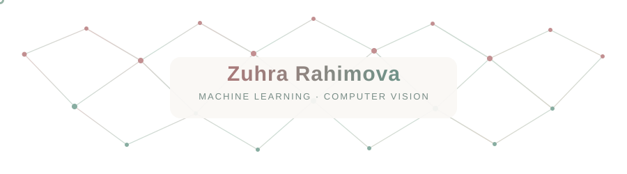

  

### ✦ welcome to my little corner of tech ✦

**Computer Science Student · Aspiring ML Engineer**

Machine Learning · Computer Vision · Data Science

---

### ✦ About Me

I'm a fourth-year **Computer Science student at Central Asian University**, interested in Machine Learning, Computer Vision, and Data Science.

I enjoy understanding how algorithms work, exploring data, and turning ideas into practical projects.

Currently focused on strengthening my Python, mathematics, and machine learning skills.

---

### ✦ Featured Projects

<table>
<tr>
<td width="50%" valign="top">

#### 01 · Crowd Counting

Crowd density estimation using OpenCV and KDE on ShanghaiTech Part B.

**MAE: 66.40**

`Python` `OpenCV` `SciPy`

[Explore Project ↗](https://github.com/rakhimovaz/Crowd-Counting)

</td>
<td width="50%" valign="top">

#### 02 · Titanic Analysis

Exploratory data analysis and visualization of passenger data.

`Python` `Pandas` `Matplotlib`

[Explore Project ↗](https://github.com/rakhimovaz/titanic-analysis)

</td>
</tr>
<tr>
<td width="50%" valign="top">

#### 03 · NLP Classification

Text classification using traditional machine learning and transformer models.

`TF-IDF` `scikit-learn` `DistilBERT`

</td>
<td width="50%" valign="top">

#### 04 · Gesture Robot

Wireless gesture-controlled robot using Arduino and motion sensing.

`Arduino` `C++` `NRF24L01`

</td>
</tr>
</table>

---

### ✦ My Toolkit

**Languages**

**Machine Learning & Data**

**Tools**

---

### ✦ Currently Exploring

- Data Structures & Algorithms
- Probability, Statistics & Linear Algebra
- Deep Learning & PyTorch
- End-to-end Machine Learning

---

*Curiosity → Learning → Building → Improving*

